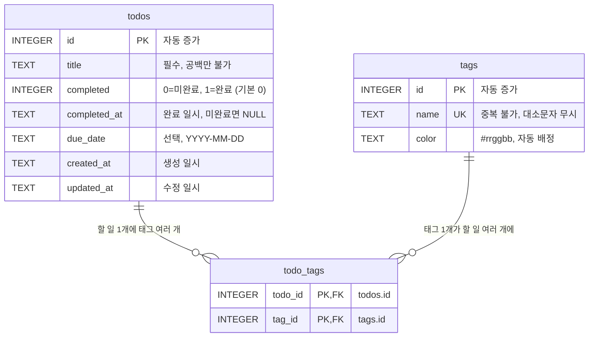

# Todo 앱 DB 설계 (SQLite)

- 근거 문서: `prd.md` (4.2 데이터 구조, 4.1 사용자 기능)
- DB: SQLite 파일 1개 `todo.db` (경로는 `.env`의 `TODO_DB_PATH`)
- 실제 생성 코드: `todo-app/lib/db.js` (7절 SQL과 동일)

## 1. 구조도 (ERD)



```
┌───────────────────────────┐       ┌───────────────────────┐       ┌───────────────────────┐
│ todos (할 일)              │       │ todo_tags (연결표)      │       │ tags (카테고리)         │
├───────────────────────────┤       ├───────────────────────┤       ├───────────────────────┤
│ PK id           INTEGER   │1     N│ PK,FK todo_id INTEGER │N     1│ PK id     INTEGER     │
│    title        TEXT 필수  ├───────┤ PK,FK tag_id  INTEGER ├───────┤ UK name   TEXT  필수   │
│    completed    0/1 기본 0 │       └───────────────────────┘       │    color  #rrggbb     │
│    completed_at TEXT      │         할 일·태그 삭제 시               └───────────────────────┘
│    due_date     TEXT 선택  │         연결 행 자동 삭제(CASCADE)
│    created_at   TEXT      │
│    updated_at   TEXT      │
└───────────────────────────┘
```

## 2. 표와 열

### todos — 할 일

| 열 | 타입 | 제약 | PRD 근거 |
|---|---|---|---|
| id | INTEGER | PK, 자동 증가 | 4.2 고유 id |
| title | TEXT | NOT NULL, 공백만 있는 값 금지 | 4.1 할 일 추가, 4.2 입력 검증 |
| completed | INTEGER | NOT NULL, 기본 0, 0 또는 1 | 4.1 완료 표시 |
| completed_at | TEXT | 완료면 일시, 미완료면 NULL (둘이 어긋나면 저장 거부) | 4.2 완료일시, 완료일 표시 |
| due_date | TEXT | NULL 허용, `YYYY-MM-DD` | 4.1 마감일 표시 / 오늘 할 일 |
| created_at | TEXT | NOT NULL, 기본 현재 시각 | 4.2 생성일시 |
| updated_at | TEXT | NOT NULL, 수정 시 갱신 | 4.2 수정일시 |

일시는 모두 UTC `YYYY-MM-DD HH:MM:SS`로 저장하고, 화면에서 현지 시간으로 바꿔 표시한다.

### tags — 카테고리(태그)

| 열 | 타입 | 제약 | PRD 근거 |
|---|---|---|---|
| id | INTEGER | PK, 자동 증가 | 4.2 고유 id |
| name | TEXT | NOT NULL, UNIQUE (대소문자 무시) | 4.2 이름 중복 불가 |
| color | TEXT | NOT NULL, `#rrggbb` 형식 | 4.2 색상 자동 배정 |

### todo_tags — 할 일 ↔ 태그 연결

| 열 | 타입 | 제약 |
|---|---|---|
| todo_id | INTEGER | FK → todos.id, 삭제 시 함께 삭제 |
| tag_id | INTEGER | FK → tags.id, 삭제 시 함께 삭제 |
| (todo_id, tag_id) | | 복합 PK: 같은 태그를 두 번 붙이지 못함 |

## 3. 관계

- **todos : tags = 다대다(N:M).** 할 일 하나에 태그 여러 개(예: "업무", "급함"), 태그 하나가 여러 할 일에 쓰임 (PRD 4.2).
- SQLite에는 다대다를 직접 표현하는 방법이 없어 연결표 `todo_tags`로 1:N + N:1로 나눴다.
- 할 일을 지우면 그 할 일의 연결 행이 지워지고, 그 결과 어느 할 일에도 붙지 않은 태그는 같은 트랜잭션에서 삭제된다 (PRD 4.2 태그 정리).

## 4. 설계 결정

1. **마감일은 날짜 문자열(`YYYY-MM-DD`)로 저장.** 날짜+시각(UTC)으로 저장하면 한국 시간 자정 전후에 날짜가 하루 밀릴 수 있다. PRD 4.2는 "현지 시간대 날짜 기준"이므로 시각 없이 날짜만 저장한다. 이 형식은 문자열 비교만으로 날짜 순서가 맞다.
2. **완료 여부는 0/1 정수.** SQLite에는 불리언 타입이 없다.
3. **completed와 completed_at은 함께 움직임.** CHECK 제약으로 "완료인데 완료일시 없음" 같은 어긋난 상태를 DB가 거부한다.
4. **태그 이름 중복은 대소문자 무시(`COLLATE NOCASE`).** "Work"와 "work"가 따로 생기지 않게 한다.
5. **태그 색상은 자동 배정.** 새 태그를 만들 때 8색 팔레트에서 순서대로 고른다. 색상 선택 화면은 PRD 범위에 없다.
6. **쓰이지 않는 태그는 자동 삭제.** 태그 관리 화면이 없으므로 남겨 두면 지울 방법이 없다. 같은 이름을 다시 쓰면 새로 만들어진다.

## 5. 기능별 조회 방법

| 기능 (PRD) | 조회 조건 |
|---|---|
| 목록 보기 | 미완료 먼저, 그다음 마감일 빠른 순 (마감일 없는 것은 뒤), 같으면 최근 등록 순 |
| 남은 할 일 개수 | `completed = 0` 개수 |
| 오늘 할 일만 보기 | `due_date = 오늘 날짜` |
| 기한 지남 표시 | `completed = 0 AND due_date < 오늘 날짜` |
| 카테고리 필터 | `todo_tags`에서 해당 `tag_id`를 가진 할 일 |
| 필터 칩 | `todo_tags`에 1개 이상 연결된 태그 |
| 검색 | `title LIKE '%키워드%'` (영문 대소문자 무시) |
| 필터 조합 | 위 조건을 AND로 결합 |

"오늘 날짜"는 화면이 사용자 컴퓨터의 현지 날짜로 계산해 API에 넘긴다.

## 6. 인덱스

| 인덱스 | 쓰이는 곳 |
|---|---|
| `todos(due_date)` | 오늘 할 일, 기한 지남, 마감일 정렬 |
| `todos(completed)` | 남은 개수, 완료 항목 정렬 |
| `todo_tags(tag_id)` | 카테고리 필터, 태그 정리 (todo_id 쪽은 복합 PK가 이미 인덱스 역할) |

## 7. SQL

```sql
PRAGMA foreign_keys = ON;  -- SQLite는 연결마다 켜야 FK가 동작함

CREATE TABLE IF NOT EXISTS todos (
  id            INTEGER PRIMARY KEY AUTOINCREMENT,
  title         TEXT    NOT NULL CHECK (length(trim(title)) > 0),
  completed     INTEGER NOT NULL DEFAULT 0 CHECK (completed IN (0, 1)),
  completed_at  TEXT,
  due_date      TEXT    CHECK (due_date IS NULL OR due_date GLOB '[0-9][0-9][0-9][0-9]-[0-9][0-9]-[0-9][0-9]'),
  created_at    TEXT    NOT NULL DEFAULT (datetime('now')),
  updated_at    TEXT    NOT NULL DEFAULT (datetime('now')),
  CHECK ((completed = 0 AND completed_at IS NULL) OR (completed = 1 AND completed_at IS NOT NULL))
);

CREATE TABLE IF NOT EXISTS tags (
  id     INTEGER PRIMARY KEY AUTOINCREMENT,
  name   TEXT    NOT NULL UNIQUE COLLATE NOCASE CHECK (length(trim(name)) > 0),
  color  TEXT    NOT NULL CHECK (color GLOB '#[0-9a-f][0-9a-f][0-9a-f][0-9a-f][0-9a-f][0-9a-f]')
);

CREATE TABLE IF NOT EXISTS todo_tags (
  todo_id  INTEGER NOT NULL REFERENCES todos(id) ON DELETE CASCADE,
  tag_id   INTEGER NOT NULL REFERENCES tags(id)  ON DELETE CASCADE,
  PRIMARY KEY (todo_id, tag_id)
);

CREATE INDEX IF NOT EXISTS idx_todos_due_date  ON todos(due_date);
CREATE INDEX IF NOT EXISTS idx_todos_completed ON todos(completed);
CREATE INDEX IF NOT EXISTS idx_todo_tags_tag   ON todo_tags(tag_id);
```

## 8. 반영 내역 (이전 "확인이 필요한 사항")

| 항목 | 결정 |
|---|---|
| 1. 완료 일시 | `todos.completed_at` 추가. 완료 시 기록, 완료 해제 시 NULL |
| 2. 태그 색상 | `tags.color` 추가. 새 태그에 팔레트 색 자동 배정 |
| 3. 쓰이지 않는 태그 | 할 일 삭제 시 연결이 없어진 태그를 자동 삭제. 필터 칩에는 사용 중인 태그만 표시 |
