# 과제 제출 기록 — 내 Todo 앱과 PRD

- PRD: [PRD.md](PRD.md) (1부 PRD + 6절 길 B 클라우드 전환)
- DB 설계: [docs/db-design-sqlite.md](docs/db-design-sqlite.md) (길 A), [supabase/schema.sql](supabase/schema.sql) (길 B)
- 길 A 코드: 커밋 `2253816` (로컬 SQLite) / 길 B 코드: 커밋 `2bf024b` 이후 `main` (Supabase)

## 한 줄 기록

- **클라우드 전환:** 로컬 SQLite(`todo.db`)에서 Supabase Postgres로 저장소를 옮기고 Supabase Auth 로그인을 추가했다. DB 접근은 백엔드 API에서만 하고, 접속 키는 서버에서만 `.env`로 읽는다.
- **RLS 확인:** 세 표 모두 RLS를 켜고 `auth.uid() = user_id` 정책을 걸었다. 사용자 A가 B의 할 일을 완료·삭제하면 404로 거부되고 B의 데이터는 그대로였으며, 로그인 없이 Supabase에 직접 접근하면 `permission denied`로 막혔다.
- **유지 확인:** 로컬(SQLite)과 Supabase 모두 서버를 완전히 껐다 켠 뒤에도 할 일과 완료 상태가 그대로 남았다.

## 확인 내역 (2026-10-29)

### 길 A — 로컬 SQLite

| 확인 | 결과 |
|---|---|
| 추가 / 목록 / 완료 / 삭제 (API 시험 26개) | 모두 통과 |
| 완료 시 완료일시 기록, 해제 시 삭제 | 통과 |
| 서버 종료 → 재시작 후 할 일 유지 | 통과 (할 일 2개, 태그 그대로) |
| 화면 코드·브라우저 번들에 DB 코드 없음 | 0건 |

### 길 B — Supabase

| 확인 | 결과 |
|---|---|
| `schema.sql` 적용 후 비로그인으로 표·함수 직접 접근 | 4건 모두 `permission denied` |
| 비로그인으로 할 일 API 호출 | 401 |
| 회원가입·로그인·로그아웃, 세션 쿠키 httpOnly | 통과 |
| 추가 / 완료(완료일시 기록) / 삭제 | 통과 |
| A 목록에 B의 할 일·태그 안 보임 | 통과 |
| A가 B의 할 일 완료·삭제 시도 → 404, B의 할 일 변화 없음 | 통과 |
| 서버 완전 종료 → 재시작 → 재로그인 후 A 2개·B 1개 유지, 완료 상태 유지 | 통과 |
| 화면 코드·브라우저 번들에 Supabase 코드·키 없음 | 0건 |
| (DB 단위) 다른 PostgreSQL 엔진에서 RLS·트리거·함수 시험 30개 | 모두 통과 |

## 작동 화면

Chrome으로 실제 앱을 조작하며 캡처했다. 각 장면 위 검은 띠는 장면 설명이다. 5번(A)·6번(B)은 서버 프로세스를 완전히 종료하고 다시 시작한 뒤 찍었다.

### 길 A — 로컬 SQLite (커밋 `2253816`)

| 1. 처음 실행 | 2. 추가 | 3. 완료 |
|---|---|---|
| 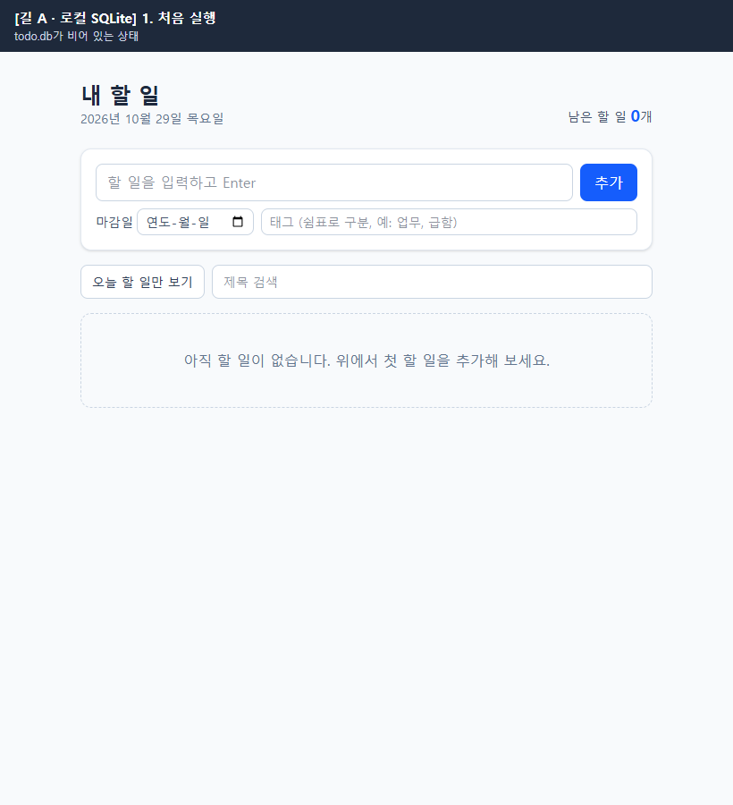 | 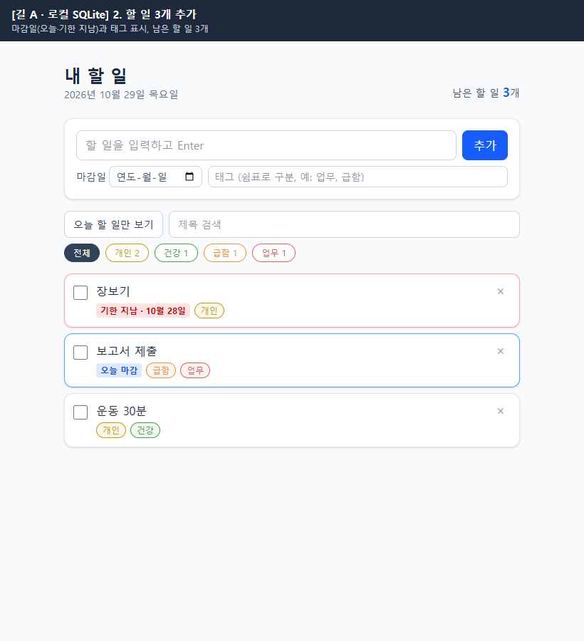 | 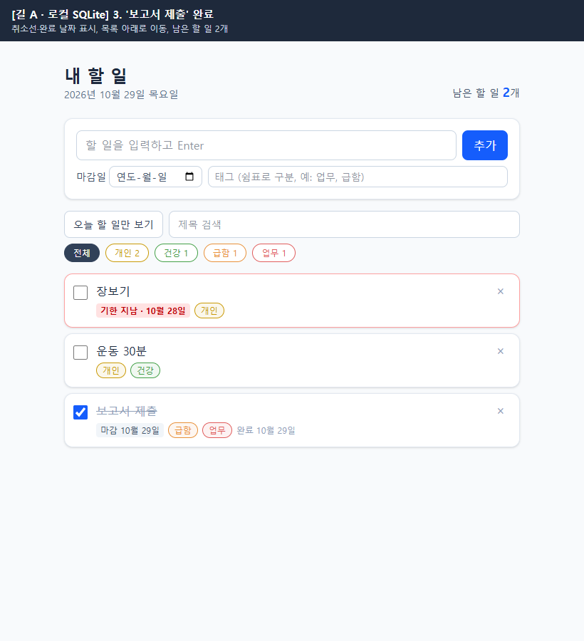 |

| 4. 삭제 | 5. 서버 재시작 후 유지 |
|---|---|
| 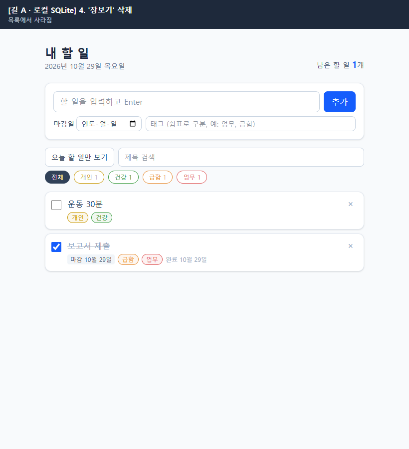 | 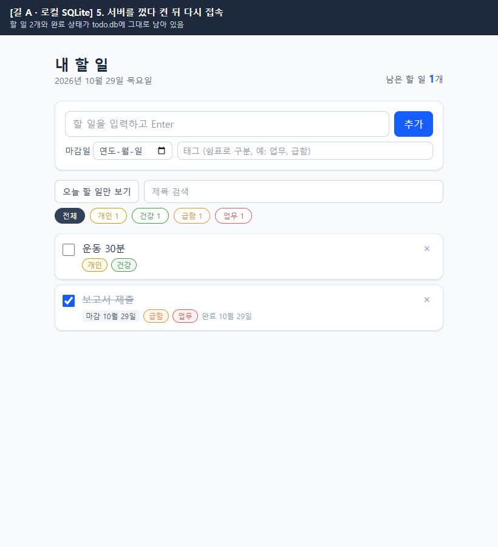 |

### 길 B — Supabase

| 1. 로그인 화면 | 2. 가입 후 빈 목록 | 3. 추가 |
|---|---|---|
| 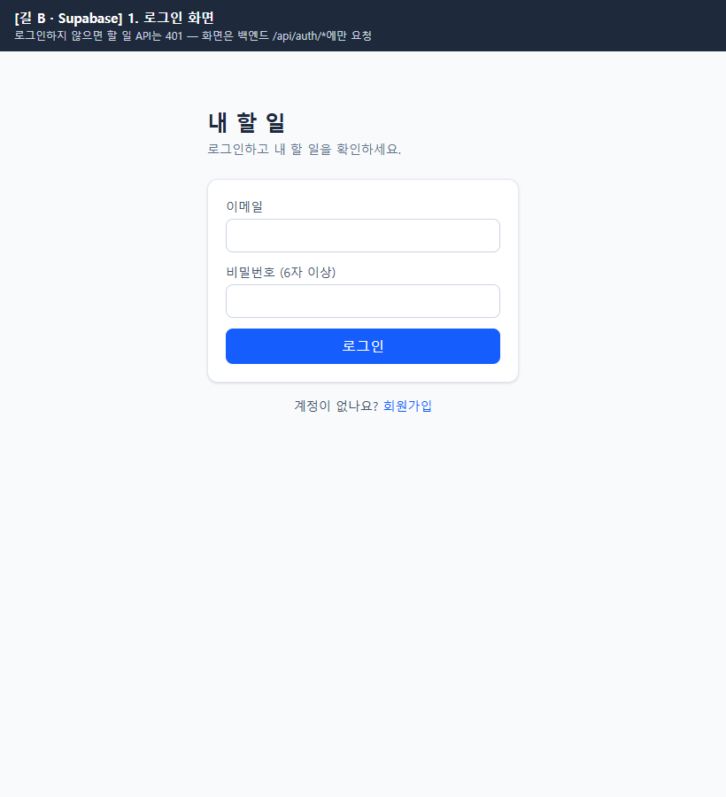 | 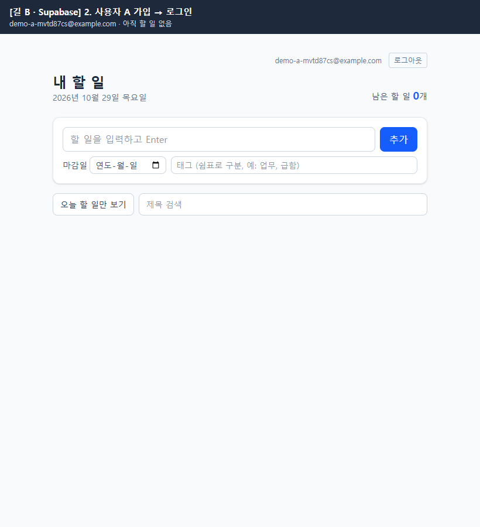 | 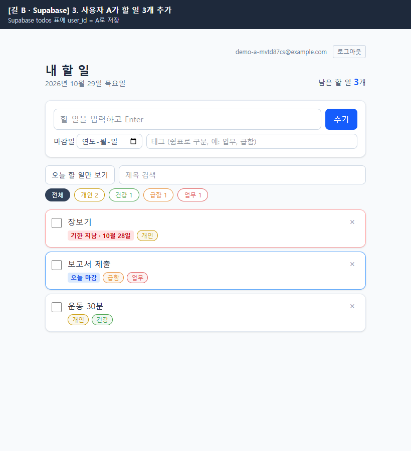 |

| 4. 완료 | 5. 삭제 | 6. 서버 재시작 후 유지 |
|---|---|---|
| 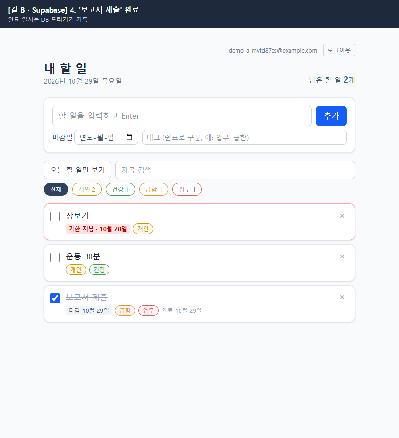 | 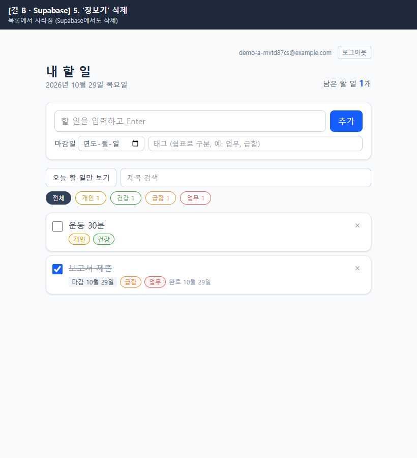 | 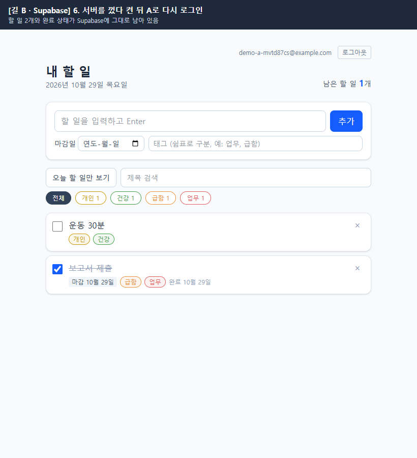 |

| 7. RLS: 사용자 B 화면 (A의 할 일 완료·삭제 시도 → 404) | 8. RLS: 시도 후 사용자 A 화면 (변화 없음) |
|---|---|
| 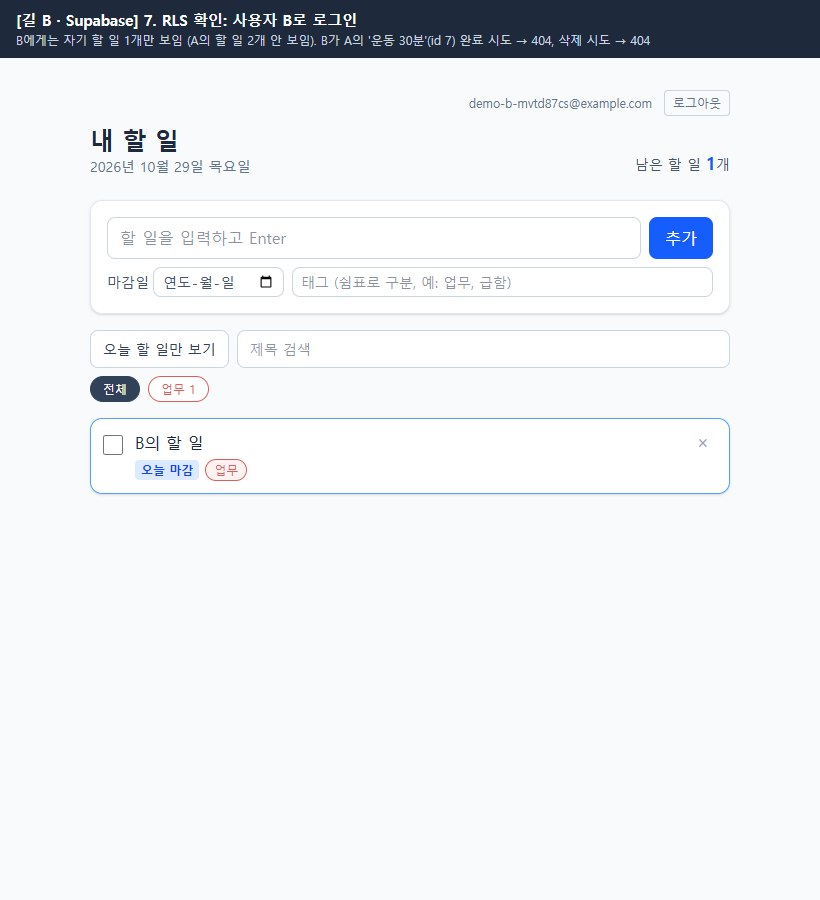 | 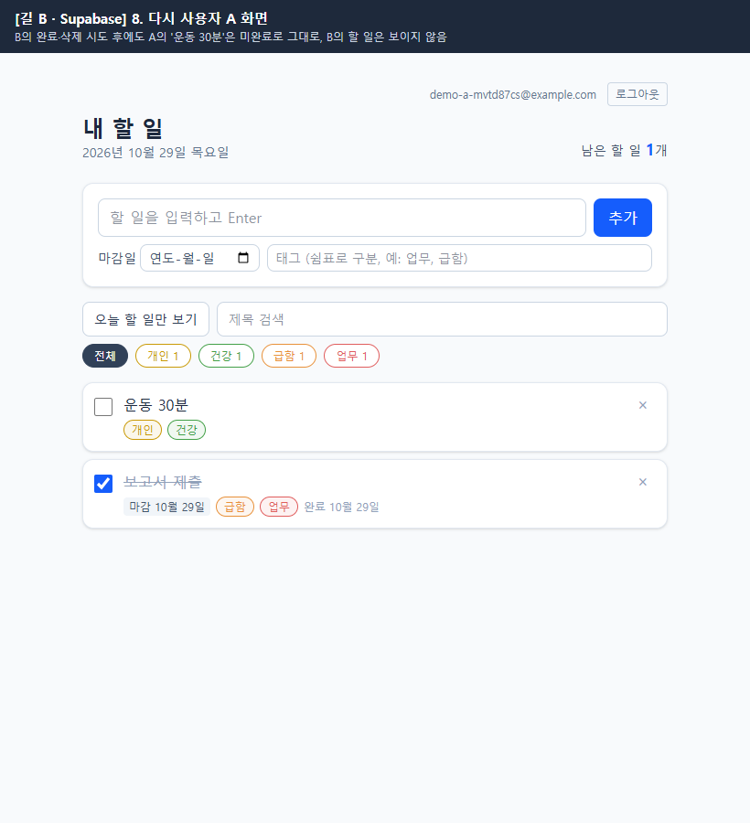 |
